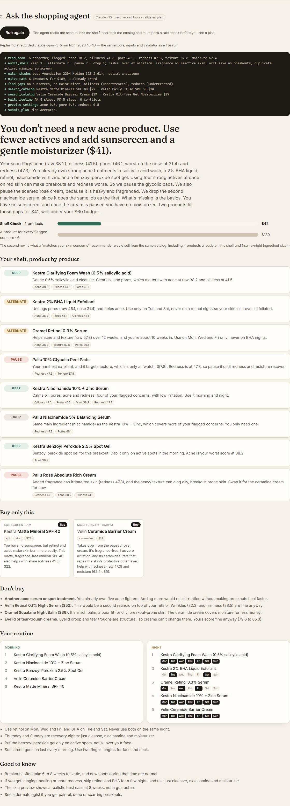

# Shelf Check

**A skincare shopping agent that helps you buy less.**

You take a selfie. YouCam's AI Skin Analysis (HD) scores 15 skin concerns and reads your skin type. You tell Shelf Check what you already own. A Claude agent reads both, checks every product against the scan, and tells you what to **keep**, what to **pause**, what to **alternate**, and the one or two things (often none) worth buying. Then YouCam Skin Simulation shows a realistic preview of sticking to the plan, and YouCam Makeup Virtual Try-On shows a look in a foundation shade matched to your measured skin tone. A few weeks later, you rescan and Shelf Check tells you, product by product, whether it is working.



## The problem

People do not wonder about their skin in the abstract. They wonder **right after a breakout**, **right before a purchase**, and **weeks into a routine they are not sure is working**. At each of those moments the usual answer is to buy another product. Very often the real fix is the opposite: the shelf already holds two exfoliants and a retinoid fighting each other, the serum in the cart treats a concern the scan scores as fine, or the new product needs four more weeks before anyone can judge it.

Shelf Check is built for those three moments:

| Moment | Persona | What the agent concludes |
| --- | --- | --- |
| Just had a breakout | Maya, 27, 8 products | "You don't need a new acne product. Use fewer actives and add sunscreen and a gentle moisturizer ($41)." |
| About to buy something | Jun, 34, $68 serum in cart | "Hold off on the $68 firming serum. A $19 barrier cream fixes your real issue: dry skin." |
| Is my routine working? | Lena, 41, rescan after 6 weeks | "The tranexamic serum is working. Pause the retinal: your redness got worse after you started it. Buy nothing." |

Each plan shows the money it saves next to a naive "one product per concern" cart built from the same scan.

## YouCam APIs used

| API | Endpoint | Used for |
| --- | --- | --- |
| File API | `POST /s2s/v2.0/file` + presigned `PUT` | Uploading the selfie once and reusing the `file_id` across tasks |
| **AI Skin Analysis (HD)** | `POST /s2s/v2.1/task/skin-analysis` | 16 HD actions in one task (22 units): wrinkle, pore, texture, acne, oiliness, radiance, eye bags, age spots, dark circles, redness, moisture, firmness, droopy upper/lower eyelid, tear trough, skin type. `raw_score` drives every decision; per-region scores (forehead, nose, cheek, crow's feet…) feed the priority rules; `mask_urls` are overlaid on the selfie when you tap a concern |
| **AI Skin Tone (Facial Color Tones)** | `POST /s2s/v2.0/task/skin-tone-analysis` | Measured skin and lip colour → CIEDE2000 foundation shade matching and undertone |
| **AI Skin Simulation** | `POST /s2s/v2.0/task/skin-simulation` | A preview of the plan's treated concerns, with intensities capped at 0.5 so the preview never promises a full correction |
| **Makeup Virtual Try-On** | `POST /s2s/v2.0/task/makeup-vto` | Foundation (matched shade), lip colour and blush as an everyday and a statement look |
| Unit balance | `GET /s2s/v1.0/client/credit` | A unit reserve guard before every live scan |

All task endpoints are polled with `GET …/{task_id}` until `success` or `error`. The client (`lib/youcam/client.ts`) retries 429 and 5xx with `Retry-After` or exponential backoff, and every request body is built by a typed, unit-tested builder (`lib/youcam/requests.ts`) that rejects mixed HD/SD actions, malformed colours and invalid makeup patterns before a unit is spent.

## How the agent works

```
selfie ──► YouCam Skin Analysis + Skin Tone ──► SkinScan (normalized, raw_score first)
                                                     │
shelf + cart + profile ─────────────────────────────►│
                                                     ▼
                      Claude (claude-opus-5-5) in a tool-use loop
     read_scan · audit_shelf · compare_scans · find_gaps · search_catalog · evaluate_cart
     build_routine · match_shades · preview_settings · naive_cart · submit_plan
                                                     │
                     submit_plan ──► deterministic validator ──► rejected? fix and resubmit
                                                     │
                                                     ▼
            Plan ──► YouCam Skin Simulation + Makeup VTO ──► preview · routine · check-in
```

- **Every fact comes from a tool.** The tools are deterministic TypeScript (`lib/rules/`): concern priorities from raw scores (act below 50, watch below 70), conflict and over-exfoliation rules, a shelf audit, gap finding, cart evaluation, an alternate-night routine builder, CIEDE2000 shade matching and a rescan comparison that ignores changes inside a ±4 noise band and judges only products started since the baseline.
- **The model may disagree with the rule baseline, but it may not break hard rules.** `submit_plan` is checked by `validatePlan` (every owned product gets a verdict, at most two new products, budget, no conflicting actives on the same night, sunscreen whenever actives are used, no retinoids when pregnant, preview intensity cap and more). Rejections go back to the model as `is_error` tool results. In the Lena run the agent overrode the baseline, pausing the retinal instead of the peel pads, because `compare_scans` tied her redness to the retinal start date.
- **Wash-off products are not leave-on actives.** A 0.5% salicylic acid cleanser stays on the skin for under a minute, so the conflict rules do not count it as an exfoliating acid; it can share a night with a retinoid. Leave-on exfoliants and stronger acid products (peel pads, acid serums) are always scheduled on separate nights.
- **The demo never depends on a live key.** Demo scenarios replay recorded agent runs (`data/agent-cache/`, keyed by a fingerprint of the input and prompt version). Custom scans run Claude live when `ANTHROPIC_API_KEY` is set, and otherwise use a deterministic offline planner that passes the same validator.

## Try it

**Hosted demo:** _link added after deploy_

1. Pick one of the three moments. The scan, the agent's trace and the plan appear in about ten seconds.
2. Tap a concern on the scan to see YouCam's detection mask (recorded scans and live selfies).
3. Scroll to **See it before you commit** for the Skin Simulation and the Makeup VTO looks.
4. On a deployment with a YouCam key, **Upload a selfie** runs the full flow on your own face. A live scan costs about 50 units. A best-effort limit of 4 scans per visitor per hour is kept in memory on each server instance; the hard guard is `YOUCAM_UNIT_RESERVE`, which refuses live scans once the balance falls to the reserve, so the demo personas keep working.

### Modes

| | No keys (default) | `YOUCAM_API_KEY` set | `ANTHROPIC_API_KEY` set |
| --- | --- | --- | --- |
| Demo personas | Sample scans in YouCam's exact response format (or recorded real responses) | Same, no units spent | Same recorded agent runs |
| Your own selfie | Disabled | Live YouCam tasks | Live Claude agent (offline planner without it) |

## Run locally

Requires Node 20.9 or newer.

```bash
npm install
cp .env.example .env.local    # optional: add YOUCAM_API_KEY and/or ANTHROPIC_API_KEY
npm run dev                   # http://localhost:3000
```

### Tests

```bash
npm test                      # 66 unit and route tests (vitest)
npm run typecheck
npm run build
npx playwright install chromium
npm run test:e2e              # the three personas end to end, plus a mobile layout check
```

### Recording real YouCam responses and agent runs

```bash
# 1. Real scans for the demo personas (about 42 units each; Lena also needs an earlier photo)
npm run record:youcam -- scan --photo maya=photos/maya.jpg --dry-run   # print requests and unit cost
npm run record:youcam -- scan --photo maya=photos/maya.jpg
# 2. Re-run the agent on the recorded scan (needs ANTHROPIC_API_KEY)
npm run precompute -- maya
# 3. Skin Simulation and Makeup VTO from the agent's plan (about 6 units)
npm run record:youcam -- preview --photo maya=photos/maya.jpg
```

HD Skin Analysis needs a photo whose short side is at least 1080 px and whose face is wider than 60% of the image. Result URLs from YouCam expire after two hours, so the script downloads masks and previews into `public/fixtures/<persona>/` and writes the responses to `lib/fixtures/recorded.ts`.

### Checking the request formats against the live API

```bash
# An image without a face: every task is accepted, then fails with error_no_face, and YouCam charges nothing for failed tasks
npx tsx --env-file=.env.local scripts/probe-youcam.ts noface.jpg
# An image with a face: the tasks succeed (about 50 units) and the results go through the app's normalizers
npx tsx --env-file=.env.local scripts/probe-youcam.ts face.jpg --face
```

`tests/youcam-live-shape.test.ts` pins a live HD Skin Analysis response (recorded on a public-domain GAN face, presigned mask URLs replaced) so the normalizer is tested against the real format, not only against the docs.

## Deploy (Vercel)

```bash
npx vercel link
npx vercel env add YOUCAM_API_KEY production       # optional
npx vercel env add YOUCAM_UNIT_RESERVE production  # e.g. 300
npx vercel --prod
```

`next.config.ts` ships `data/agent-cache/` with the agent route, so replays work on serverless functions.

## Project layout

```
app/                 Next.js App Router page and API routes (status, youcam upload/tasks, agent)
components/          Scan, face map, shelf, agent trace, plan, preview and check-in views
lib/youcam/          Typed YouCam client, request builders, response normalizers, live/fixture service
lib/rules/           Deterministic skincare rules (analysis, conflicts, shelf, shopping, routine, color, progress)
lib/agent/           Tools, prompt, tool-use loop, plan schema + validator, replay cache, offline planner
lib/catalog/         Demo catalog of fictional brands
lib/fixtures/        Personas (sample YouCam outputs) and recorded responses
scripts/             record-youcam.ts, precompute-agent.ts
tests/, e2e/         vitest and Playwright
```

## Notes

- Shelf Check is shopping guidance, not medical advice.
- Product names and brands in the demo catalog are fictional. Persona scans are sample data unless marked as recorded.
- Selfies are sent to YouCam only when you scan your own photo; the app stores nothing server-side. A baseline scan for check-ins is kept in your browser's local storage.

## License

MIT. See [LICENSE](LICENSE).
